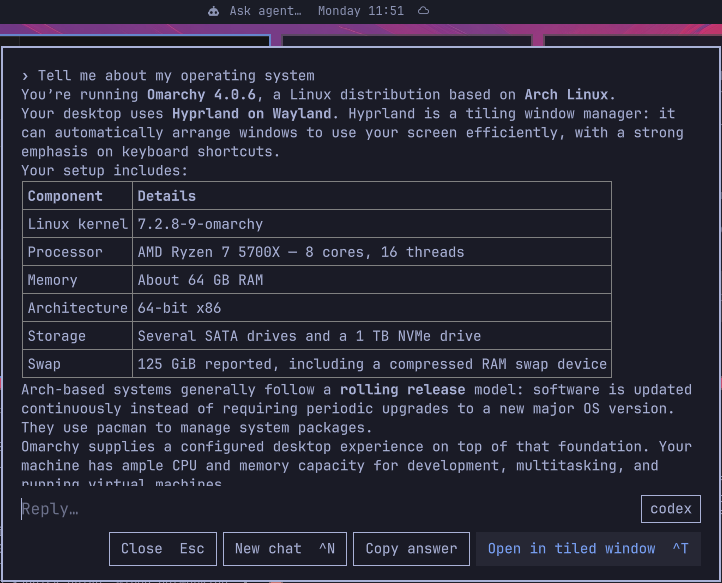

# Ask agent



An "Ask agent…" button for the Omarchy bar. Click it, type a question, and the
answer appears in a small overlay under the bar. Reply in the same box to keep
going, or open the conversation in a tiled terminal window.

It uses whatever you set with `omarchy default agent`, so no agent is hard-coded.

## How it works

- The bar button opens a prompt overlay (`omarchy-shell shell toggle io.github.jordan-alcock.ask-agent '{}'`).
- Enter sends the question to your default agent in headless mode and shows the answer as markdown.
- **Tested:** Claude Code, Cursor CLI, Codex and GitHub Copilot.
- **Claude Code and GitHub Copilot:** follow-ups resume the same session, and "Open in tiled
  window" (`Ctrl+T`) resumes it in a terminal with `omarchy-launch-tui`.
- **Cursor CLI and Codex:** each follow-up resends the earlier turns in the prompt.
- **Gemini and opencode:** supported the same way as Cursor and Codex, but untested.
- **Any other default agent:** skips the overlay and runs `omarchy agent prompt "<question>"`.

The conversation is kept when you close the box or restart the shell, and cleared when you
open it in a tiled window or start a new chat.

Select answer text with the mouse and copy it with `Ctrl+C`, or use **Copy answer** for the latest reply. Paste works in the reply box. Omarchy's `SUPER + C`, `SUPER + V` and `SUPER + X` work too,
as do `Ctrl+C/V/X` and `Ctrl/Shift+Insert`. With nothing selected, copy takes the latest answer.

Pick which installed agent answers with the dropdown at the right of the reply box (it
defaults to your `omarchy default agent` and locks once a chat has started). Open it from the
keyboard with a binding, e.g. in `~/.config/hypr/bindings.lua`:

```lua
o.bind("SUPER + A", "Ask agent", "omarchy-shell shell toggle io.github.jordan-alcock.ask-agent '{}'")
```

Keys: `Enter` send · `Ctrl+T` open in tiled window · `Ctrl+N` new chat · `Esc` close.

## Install

```bash
omarchy plugin add https://github.com/jordan-alcock/Omarchy-Ask-Agent.git --enable
omarchy bar move io.github.jordan-alcock.ask-agent --section center --index 0
omarchy restart shell
```

The shell keeps this plugin loaded, so restart it after installing or updating.

## Requirements

| Needs | Why |
|---|---|
| Omarchy 4 (Quattro, `omarchy-shell`) | the plugin is a bar widget plus an overlay |
| A default agent: `omarchy default agent <name>` | the agent that answers |
| `claude`, `copilot`, `cursor-agent`, `codex`, `gemini` or `opencode` on `PATH` | headless answers in the overlay |

Your questions go only to the agent CLI you already use. The current conversation is saved,
unencrypted, to `$XDG_STATE_HOME/omarchy/ask-agent/conversation.json` (default
`~/.local/state/…`) until you open it in a terminal or start a new chat. The folder is owner-only (`700`).

## Removal

```bash
omarchy plugin remove io.github.jordan-alcock.ask-agent
rm -rf ~/.local/state/omarchy/ask-agent   # saved conversation (or under $XDG_STATE_HOME)
omarchy restart shell
```

## License

MIT, see [LICENSE](LICENSE).
